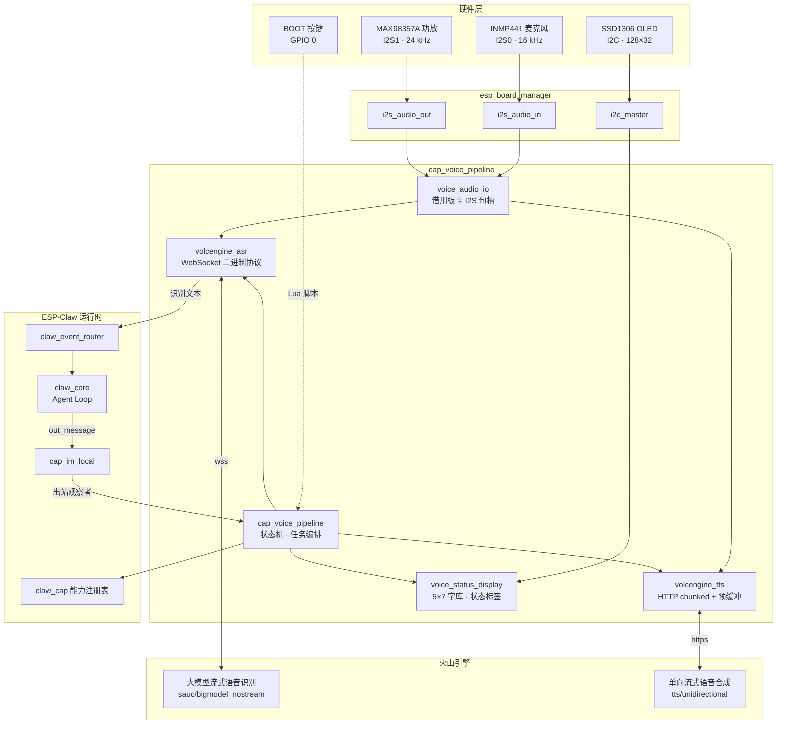
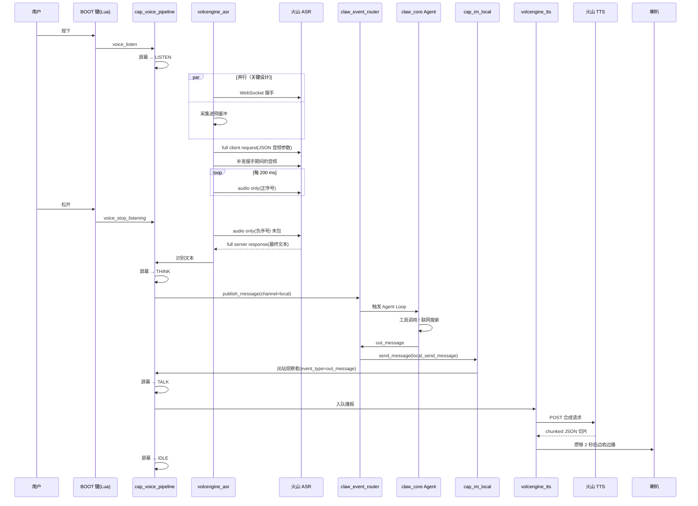
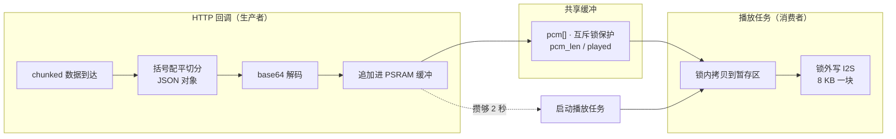
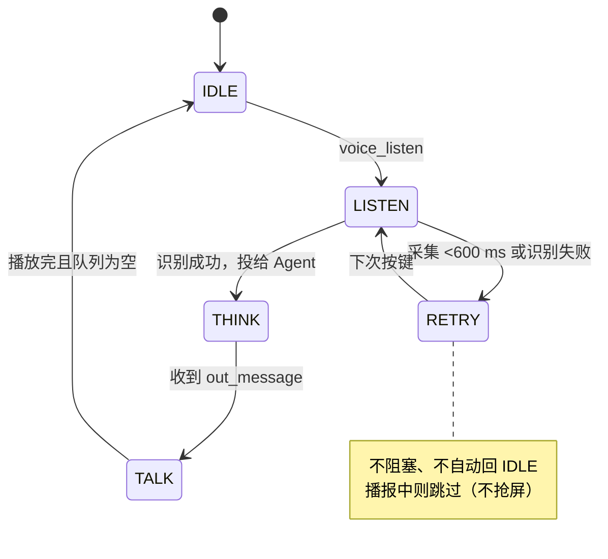

# 语音交互管线设计文档（cap_voice_pipeline）

> 分支：`feature/voice-asr-tts`（基线 tag `baseline-before-voice-port`）
> 目标硬件：ESP32-S3-DevKitC-1（16 MB Flash / 8 MB PSRAM）+ INMP441 麦克风 + MAX98357A 功放 + 0.91" SSD1306 OLED
> 云端服务：火山引擎豆包语音（大模型流式识别 + 单向流式合成）

---

## 1. 背景与目标

ESP-Claw 原生的交互入口是 IM（微信/飞书/Telegram/QQ）和网页聊天，没有语音。本分支把
[xiaozhi-esp32](https://github.com/78/xiaozhi-esp32) 的音频接线方案移植过来，但**不搬它的代码结构**——
xiaozhi 是围绕单一状态机写死的语音固件，而 ESP-Claw 是能力（capability）+ 事件路由的 Agent 运行时，
两者的事件模型不兼容。

因此语音在本设计中被定位为**一个普通的输入输出通道**，与微信、飞书平级：

- 识别出的文本作为一条普通用户消息投进 `claw_event_router`
- Agent 的最终回复经 `cap_im_local` 的出站观察者转成语音播报

这样语音天然复用了 Agent 已有的一切：LLM 推理、工具调用、Lua 动态脚本、端侧记忆、联网搜索。

### 最终形态

```
按住 BOOT 键说话  →  流式识别  →  Agent 思考 / 联网 / 调工具  →  语音播报答案
                                        ↕
                              OLED 显示当前状态
```

---

## 2. 整体架构



### 模块职责

| 文件 | 行数 | 职责 |
| --- | --- | --- |
| `cap_voice_pipeline.c` | 755 | 状态机、任务编排、capability 注册、TTS 队列 |
| `volcengine_asr.c` | 755 | 流式识别客户端，WebSocket 二进制分帧 |
| `volcengine_tts.c` | 770 | 流式合成客户端，chunked JSON 切分、base64、生产者/消费者播放 |
| `voice_status_display.c` | 487 | SSD1306 驱动 + 5×7 字库 + 状态标签 |
| `voice_audio_io.c` | 168 | 向板卡管理器借用 I2S 通道，校验采样率 |
| `voice_pipeline_private.h` | 109 | 组件私有接口 |

---

## 3. 功能特性清单

本分支共 31 个提交、约 3450 行新增代码。按功能域归类如下（✅ 已实测通过，⚠️ 有已知限制）。

### 3.1 语音识别（ASR）

| 特性 | 状态 | 说明 |
| --- | --- | --- |
| 火山引擎 v3 流式识别集成 | ✅ | `wss://.../api/v3/sauc/bigmodel_nostream`，替代初版的 v1 REST 接口 |
| 自定义二进制协议分帧 | ✅ | 大端序，header/sequence/payload-size 三段，四种消息类型 |
| 末包负序号标记 | ✅ | 双缓冲始终留一块音频，确保末包携带真实音频而非空包 |
| 握手与采集并行 | ✅ | 抢救回握手期间约 800 ms 音频，按下即说不再丢开头 |
| 采集时长下限保护 | ✅ | <600 ms 判定为误触，不发末包、不等转写 |
| 错误帧正确解析 | ✅ | `header \| error_code \| message_size \| message`，鉴权失败可诊断 |
| 服务端响应日志 | ✅ | 完整打印 JSON，便于定位服务端问题 |
| 免按键 VAD 断句 | ⚠️ 未做 | 目前靠按住说话界定句子边界 |

### 3.2 语音合成（TTS）

| 特性 | 状态 | 说明 |
| --- | --- | --- |
| 火山引擎 v3 单向流式合成 | ✅ | `POST /api/v3/tts/unidirectional`，HTTP chunked |
| chunked JSON 增量切分 | ✅ | 括号配平扫描，跳过字符串内的括号与转义 |
| base64 解码 + PCM 直推 | ✅ | 不需要 MP3 解码器，采样率取板卡实际配置 |
| **预缓冲流式播放** | ✅ | 攒够 2 秒即开播，合成等待 12.5 s → 2.3 s |
| 生产者/消费者解耦 | ✅ | 播放在独立任务，避免阻塞 HTTP 回调导致 DMA 饿死 |
| **I2S 分块写入** | ✅ | 8 KB 一块，修复整段写入必然超时的缺陷 |
| **Markdown 过滤** | ✅ | 设备侧清理 `**` / `` ` `` / `#` / 列表 / `[文字](链接)`，避免念成"星星你好星星" |
| 播放互斥 | ✅ | Agent 回复与 `voice_speak` 工具调用不会在 I2S 上串音 |
| TTS 任务队列 | ✅ | 回调只入队，不阻塞消息投递任务（原会阻塞最长 20 s） |
| 成功码兼容 | ✅ | 同时接受 `0` 与线上实际返回的 `20000000` |

### 3.3 音频硬件层

| 特性 | 状态 | 说明 |
| --- | --- | --- |
| 板卡管理器音频接入 | ✅ | `esp_board_periph_ref_handle()` 借用 I2S 通道，capability 不碰 GPIO |
| 采样率运行时校验 | ✅ | 从板卡配置读取，麦克风非 16 kHz 直接报错退出 |
| 引脚冲突预检 | ✅ | `esp_gpio_is_reserved()` 预检并点名冲突引脚（IDF 的 I2S 只警告不报错） |
| **Dummy codec 启动修复** | ✅ | `CONFIG_CODEC_DUMMY_SUPPORT=y`，消除 `audio_dac` 每次启动的三行报错 |
| 引用计数正确性 | ✅ | `ref_handle` / `unref_handle` 配对，避免板卡 deinit 后留下悬空句柄 |

### 3.4 触发方式

| 特性 | 状态 | 说明 |
| --- | --- | --- |
| **Push-to-talk（按住说话）** | ✅ | 板载 BOOT 键 GPIO 0，无需接线；松手即停，绕开 VAD |
| **IM `/listen` 指令** | ✅ | 飞书/微信等任意已绑定通道，router 规则实现，无需改 C 代码 |
| 控制台调用 | ✅ | `cap call voice_listen {}` |
| Agent 自主调用 | ✅ | `voice_listen` / `voice_stop_listening` / `voice_speak` 三个工具 |
| 内置 skill 打包 | ✅ | 按键脚本随固件进只读 SYSTEM 镜像，开机 router 规则常驻拉起 |
| 唤醒词 | ⚠️ 未做 | 需 ESP-SR / WakeNet，模型占 flash、麦克风需常开 |

### 3.5 OLED 状态显示

| 特性 | 状态 | 说明 |
| --- | --- | --- |
| SSD1306 驱动（C 侧） | ✅ | 128×32，页寻址，自建帧缓冲 |
| I2C 地址自动探测 | ✅ | `i2c_master_probe()` 试 0x3C / 0x3D |
| **状态显示** | ✅ | `IDLE` / `LISTEN` / `THINK` / `TALK` / `RETRY?` |
| 5×7 字库 + 缩放渲染 | ✅ | A-Z、0-9、常用标点；状态标签 3 倍、消息 2 倍 |
| 状态转换互斥 | ✅ | 采集任务与播放任务并发写屏不会撕裂 |
| 状态优先级 | ✅ | 播报中不被 `RETRY?` 抢屏；多段回复不闪回 IDLE |
| `display_text` capability | ✅ | Agent 可主动写屏，仅在探测到面板时才注册 |
| 中文显示 | ⚠️ 不支持 | 5×7 字库无中文字形，capability 描述里已声明 |
| 纳入板卡管理器 | ⚠️ 未做 | 目前由本组件直驱，Lua 的 `display`/`lcd` 模块用不了它 |

### 3.6 ESP-Claw 框架集成

| 特性 | 状态 | 说明 |
| --- | --- | --- |
| 识别文本投递事件路由 | ✅ | `claw_event_router_publish_message(channel=local)` |
| **`local` 出站 channel 绑定** | ✅ | 框架原本只绑定了 qq/feishu/telegram/wechat/web，缺 `local` 导致回复被丢弃 |
| **出站观察者机制** | ✅ | 给 `cap_im_local` 新增观察者列表，语音以观察者接入，不再抢占网页聊天的主回调 |
| `event_type` 透传 | ✅ | 只播报 `out_message`，不念"正在处理"和每次工具调用的流水账 |
| **能力对大模型可见** | ✅ | 新增 `claw_cap_add_llm_visible_group()`；原先注册后仍不可见，Agent 完全看不到语音与屏幕工具 |
| 语音回复长度约束 | ✅ | `soul.md` 按 `source_chat_id: voice_user` 限制五句话，不影响 IM 通道 |

### 3.7 板级支持与配置

| 特性 | 状态 | 说明 |
| --- | --- | --- |
| **新增 `esp32_S3_DevKitC_1_voice` 板型** | ✅ | 独立板卡定义，不改动上游原板型 |
| I2S 麦克风/喇叭声明 | ✅ | INMP441（I2S0/16 kHz/左声道）+ MAX98357A（I2S1/24 kHz） |
| I2C OLED 声明 | ✅ | GPIO 41/42 |
| **16 MB Flash 启用** | ✅ | 原为 8 MB，半片 flash 闲置；应用分区 0x3b6000 → 5 MB |
| Kconfig 开关真实生效 | ✅ | 关闭后语音代码完全不编译（约省 10 KB） |
| `CONFIG_WS_BUFFER_SIZE=4096` | ✅ | 默认 1024 装不下 ASR 网关的握手响应头 |

### 3.8 Web 配置界面

| 特性 | 状态 | 说明 |
| --- | --- | --- |
| **语音设置页面** | ✅ | 侧边栏「语音服务 (ASR/TTS)」，SolidJS |
| 单 API Key 模型 | ✅ | 新版控制台只需一个 `X-Api-Key`，识别与合成共用 |
| 一键填充默认端点 | ✅ | 页头按钮，仅 API Key 需手填 |
| 前端类型检查通过 | ✅ | 初版有 37 个类型错误导致页面白屏（`pnpm build` 不做类型检查） |
| NVS 键名隔离 | ✅ | v3 键名加后缀，避免已配置设备沿用 v1 的 `https://` 地址喂给 WebSocket |

### 3.9 构建与依赖

| 特性 | 状态 | 说明 |
| --- | --- | --- |
| **CMake 依赖修复** | ✅ | 组件 `REQUIRES` 恒定声明（IDF 两次解析，条件声明会静默丢依赖） |
| `EXTRA_COMPONENT_DIRS` 补齐 | ✅ | 加入 `claw_capabilities` 搜索路径 |
| 第三方驱动适配 ESP-IDF 6.0 | ✅ | `esp_lcd_gc9107` / `esp_lcd_gc9d01` 的 `rgb_ele_order` 枚举、`ir_learn` 的 `esp_driver_rmt` 依赖 |
| **改动组件迁入工程目录** | ✅ | 上述三个组件从 `managed_components/` 迁至 `application/edge_agent/components/` 并纳入版本控制——包管理器对改动过的托管组件做哈希校验，会拦截 `idf.py fullclean` |
| `lua_module_lcd` v6 兼容 | ✅ | `esp_lcd_nt35510` 头文件条件宏保护 |

> **说明**：上述三个第三方驱动**并非新增依赖**，而是原本就由包管理器下载的托管组件（`managed_components/` 在 .gitignore 中）。
> 因为需要改造以适配 ESP-IDF 6.0，按官方规范迁入工程自有目录并提交，避免哈希校验冲突。

---

## 4. 云端方案选型

### 4.1 ASR：为什么选流式识别而不是录音文件识别

火山引擎提供两类语音识别，形态完全不同：

| | **大模型流式识别（选用）** | 录音文件识别（否决） |
| --- | --- | --- |
| 接口 | `wss://.../api/v3/sauc/bigmodel_nostream` | `POST /api/v3/auc/bigmodel/submit` + 轮询 `query` |
| 音频怎么给 | 设备直接推 PCM 字节流 | **`audio.url` 必填**，只接受音频链接 |
| 额外依赖 | 无 | **需要一个公网可访问的对象存储** |
| 交互次数 | 1 条 WebSocket | 上传 + submit + 轮询 N 次 |
| 延迟 | 5 s 音频约 300~400 ms 出结果 | 上传 + 排队 + 轮询，秒级起 |
| 定位 | 实时语音交互 | 离线批量转写（限制 <512 MB） |

**决定性因素**：录音文件识别的 `audio.url` 是必填项，没有任何直接 POST 音频字节的途径。
ESP32 得先把录音传到公网可达的地方——而设备的 HTTP 服务在局域网内（`192.168.3.x`），
火山的云端根本连不进来。"HTTP 比 WebSocket 简单"这个直觉在这里是反的：
HTTP 那条路把复杂度转移到了"你得先有个公网文件服务"，工作量远大于实现二进制分帧。

流式识别又分三种端点，选了 **`bigmodel_nostream`（流式输入模式）**：

- `bigmodel`：双向流式，边说边出字，但 Agent 只消费完整句子，中间结果会被丢弃
- `bigmodel_async`：双向流式优化版，同上
- **`bigmodel_nostream`：准确率更高**，末包后返回最终结果 —— 正是我们要的

### 4.2 TTS：为什么选 HTTP 单向流式

三种合成接口能力等价，只是传输方式不同：

| 接口 | 传输 | 评价 |
| --- | --- | --- |
| **单向流式 HTTP（选用）** | HTTP chunked | 复用现有 `esp_http_client`，零新增协议栈 |
| 单向流式 WebSocket | WebSocket | 需额外实现二进制分帧，收益为零 |
| 双向流式 WebSocket | WebSocket | TTS 是"一次文本进、音频流出"，用不上双向能力 |

且文档明确写"流式场景推荐使用 pcm"，而 **PCM 正是 I2S 能直接播的格式**——不需要 MP3 解码器。
合成采样率直接取板卡喇叭通道的实际配置（24 kHz），固件端零重采样。

### 4.3 鉴权

新版控制台只需**一个 `X-Api-Key`**，识别与合成共用。旧版控制台的
`X-Api-App-Key` + `X-Api-Access-Key` 组合已不需要。

| 服务 | Header |
| --- | --- |
| ASR | `X-Api-Key` / `X-Api-Resource-Id: volc.seedasr.sauc.duration` / `X-Api-Request-Id` / `X-Api-Sequence: -1` |
| TTS | `X-Api-Key` / `X-Api-Resource-Id: seed-tts-2.0` / `X-Api-Request-Id` |

---

## 5. 端侧实现

### 5.1 完整交互时序



### 5.2 ASR 二进制协议

火山流式识别用自定义二进制帧（整数**大端**）：

```
byte 0: 协议版本(4b) | 头长度(4b，单位=4字节)
byte 1: 消息类型(4b) | 类型标志(4b)
byte 2: 序列化方式(4b) | 压缩方式(4b)
byte 3: 保留
[4 字节 sequence，当标志位声明时]
4 字节 payload 长度
payload
```

| 消息类型 | 值 | 用途 |
| --- | --- | --- |
| full client request | `0b0001` | 首包，JSON 声明音频格式 |
| audio only request | `0b0010` | 音频数据包 |
| full server response | `0b1001` | 识别结果 |
| error | `0b1111` | 服务端错误 |

**末包用负序号标记**（标志 `0b0011`），这是"请给我最终结果"的信号。实现上用**双缓冲**
始终留一块音频不发，等确认没有下一块了，才把它作为负包发出去——保证末包携带真实音频而非空包。

### 5.3 TTS 流式播放的生产者/消费者



三个关键点：

1. **播放必须在独立任务里**。若在 HTTP 回调里直接播，`i2s_channel_write` 会阻塞回调，
   反过来节流 TCP 接收，DMA 饿死 → 爆音。
2. **消费者在锁内拷贝、锁外写**。生产者扩容缓冲时会 `realloc`，消费者若跨越扩容持有旧指针
   就是 use-after-free。
3. **扩容的大块拷贝必须在锁外做**。上层翻倍时是几 MB 的 PSRAM 拷贝，持锁会把播放任务饿死。

### 5.4 状态显示



128×32 单色屏画不了有意义的表情（实测用户反馈"这个看着有点抽象啊"），改用
**3 倍放大的 5×7 字库**显示 `IDLE` / `LISTEN` / `THINK` / `TALK` / `RETRY?`。

### 5.5 触发方式

| 方式 | 实现 | 说明 |
| --- | --- | --- |
| **按住说话** | `push_to_talk.lua` + `lua_module_button` | BOOT 键（GPIO 0），按下 `voice_listen`、松开 `voice_stop_listening`。**松手即停，绕开了做 VAD 的工程量** |
| IM 指令 | router 规则 `/listen` 前缀 | 飞书/微信等任意已绑定通道 |
| 控制台 | `cap call voice_listen {}` | 调试用 |
| Agent 自主 | LLM 工具调用 | `voice_listen` / `voice_speak` / `display_text` |

按键脚本作为**固件内置 skill** 放在组件的 `skills/` 目录，构建时进只读 SYSTEM 镜像
（`/system/skills/voice_push_to_talk/`），由开机 router 规则以 `lua_run_script_async` 常驻拉起。

---

## 6. 踩坑记录

> 这一节按类别整理开发过程中实际遇到的问题。多数不是"写错一行"，而是**假设与现实不符**。

### 6.1 构建系统

**① 组件 CMakeLists 的 `REQUIRES` 不能用 `if(CONFIG_xxx)` 包起来**

ESP-IDF 会**两次解析**组件 CMakeLists，第一次（依赖展开阶段）`CONFIG_*` 尚未定义，
`else()` 分支生效导致依赖全部丢失，报 `cJSON.h: No such file`。

正解：`REQUIRES` 恒定声明，用源码内 `#if CONFIG_xxx` 做条件编译。

**② IDF v6 中 `json` 组件已不存在**，cJSON 由 managed component `espressif__cjson` 传递引入。

**③ 修改过的 `managed_components` 会阻塞 `idf.py fullclean`**

包管理器做哈希校验，检测到文件被改会拦截。正解：把改过的组件迁到工程自有的 `components/` 目录。

### 6.2 硬件与板卡

**④ `slot_mask` 抄错导致采集速率翻倍**

从别的板卡抄了 `slot_mode: MONO` + `slot_mask: I2S_STD_SLOT_BOTH`。MONO 模式下用 BOTH
会**同时采集两个 slot**，字节率翻倍、数据变成交错流，服务端拿到无法解码的内容后直接关连接，
**一个结果帧都不回**。

发现方式：日志显示"录了 4000 ms"但墙钟只过了 1997 ms —— **正好 2 倍**。
正解：INMP441 的 L/R 接地，只驱动左声道，应为 `I2S_STD_SLOT_LEFT`（xiaozhi 的
`no_audio_codec.cc:48` 即如此）。

**⑤ 引脚冲突：ESP-IDF 的 I2S 只警告不报错**

```c
// esp_driver_i2s/i2s_common.c:893
if (!used_by_pair_chan && (esp_gpio_reserve(BIT64(gpio_num)) & BIT64(gpio_num))) {
    ESP_LOGW(TAG, "GPIO %d is not usable, maybe conflict with others");
}   // ← 只警告，继续执行，引脚被抢走
```

所有 `if (ret != ESP_OK)` 检查全部通过，初始化"成功"，实际上把 LCD 的 SPI 时钟、MOSI、CS
和背光都抢了。**六个引脚全部撞车而毫无察觉。**

正解有两层：
- 短期：初始化前用 `esp_gpio_is_reserved()` 预检，冲突则明确失败
- 根治：**改用板卡管理器的 `i2s_audio_in` / `i2s_audio_out`**，capability 完全不碰 GPIO，
  冲突在结构上不可能发生

**⑥ `esp_board_periph_get_handle` vs `ref_handle`**

前者不做惰性初始化、不引用计数；后者两者都做。用错了会在板卡之后 deinit 音频设备时留下悬空句柄。

**⑦ 采样率不能靠 Kconfig 猜**

应当用 `esp_board_manager_get_periph_config()` 读板卡真实配置。写死 24 kHz 会在
任何 YAML 不同的板子上悄悄坏掉（如 48 kHz 的板子会以半速播放）。

**⑧ `CONFIG_CODEC_DUMMY_SUPPORT` 默认关闭**

MAX98357A 是没有控制接口的裸功放，板卡管理器用 "dummy" codec 承载它，但该条目
默认不编进注册表，导致每次启动报 `Unsupported codec: dummy` + `Failed to init device: audio_dac`。

### 6.3 协议与云服务

**⑨ `CONFIG_WS_BUFFER_SIZE` 默认 1024 太小**

`transport_ws.c` 用**同一个缓冲区**既拼握手请求、又读握手响应，找不到 `\r\n\r\n` 就放弃。
字节跳动网关的响应头带大量 trace 字段超过 1023 字节，握手直接失败。

**极易踩的坑**：`esp_websocket_client_config_t.buffer_size` 是**另一个**缓冲区（收发数据帧），
设它没用。必须调 `CONFIG_WS_BUFFER_SIZE`。

**⑩ `20000000` 才是成功码，不是 `0`**

TTS 文档的响应示例写 `"code": 0`，但线上实际返回 `20000000`（火山语音接口族共用的错误码表里
`20000000 = 成功`）。照文档示例写 `code != 0 就是错误`，会导致**声音正常播出但返回失败**——
因为报错的是音频之后的收尾包。

**⑪ 错误帧格式与普通帧不同**

ASR 错误帧是 `header | error_code(4) | message_size(4) | message`，把 error_code 当成
payload 长度解析，鉴权失败时打出来的是二进制乱码而非可诊断的错误码。

**⑫ 服务端产出速度的测量会被自身实现污染**

最初测得"TTS 只有实时的 59%"，据此得出"必须全部收完才能播"。但那次测量时播放内联在
HTTP 回调里，`i2s_channel_write` 阻塞回调**反过来节流了 TCP 接收**——测到的是耦合系统的速度。
播放解耦后重测是 **114~122%**，于是可以改成预缓冲 2 秒即开播，合成等待从 12.5 秒降到 2.3 秒。

**教训**：测量前先确认测的是被测对象，而不是自己的实现。

### 6.4 并发与内存

**⑬ ESP-IDF 的 `xTaskCreate` 栈大小单位是字节，不是字**

`task.h:576` 明确写 "the stack size DEFINED IN BYTES"。在 4096 字节的任务里放了
8192 字节的局部数组，**每次播报都会踩栈**。这也正好违反仓库 CLAUDE.md 里"栈变量不超过 128 字节"
的规定——那条规则就是为防这个存在的。

**⑭ join 超时后释放共享状态 = use-after-free**

给播放任务的 join 设了 30 秒超时，超时后直接 `vSemaphoreDelete` + `free(pcm)` + 函数返回。
但 `stream` 是**栈上局部变量**，播放任务还活着，下一步就去 take 已删除的信号量、
memcpy 已释放的内存、写已被复用的栈帧。而 60 秒的音频上限配 30 秒 join 超时，
这条路径**结构性可达**。

正解：播放任务内部所有等待都有界（每块 I2S 写有超时、互斥锁只短暂持有），必然结束，
所以 join 改成无限等待反而是安全的。

**⑮ 单槽位回调被静默覆盖**

`cap_im_local` 的出站回调是单槽位、后写覆盖前写。语音管线初始化时覆盖了网页聊天的
投递回调，导致**网页聊天页从此收不到任何回复且无任何报错**。

正解：给 `cap_im_local` 增加独立的**观察者列表**——主回调仍归网页聊天所有、返回值照常传播，
语音以观察者身份接入，出错只记日志不影响投递。

**⑯ 用后即释放的配置指针**

`main.c` 把 `s_config` 传进来，却在 `app_main` 结尾 `free()` 掉。语音管线一直持有这个指针，
之后每次读 API Key 都是读已释放内存。（`app_claw_start` 是拷贝的，只有这个 capability 是例外。）

### 6.5 集成与可见性

**⑰ 注册 capability ≠ 大模型能看见它**

这是最隐蔽的一个。`app_claw_start()` 在启动时调用 `claw_cap_set_llm_visible_groups()`，
列表来自静态表；而语音 capability 是在 `app_claw_start` **之后**从 `main.c` 注册的，
不在可见列表里。

后果：`cap list` 能列出 `voice_listen` / `display_text`，控制台也能调用，**但大模型完全看不见**。
用户让它"在屏幕上显示文字"，它转了 11 轮、扫了 I2C 总线，最后回答"这个设备没有屏幕"——
它不是判断失误，是真的看不到工具。

正解：给 claw_cap 增加 `claw_cap_add_llm_visible_group()`（原来只有整体替换），
注册后追加。注意**列表为空时必须 no-op**，因为空列表本身就是"全部可见"的意思，
这时追加一项反而会隐藏其他所有 group。

**⑱ 出站投递需要 channel 绑定**

`app_claw` 只绑定了 `qq`/`feishu`/`telegram`/`wechat`/`web`，唯独没有 `local`——
而这恰恰是 `cap_im_local` 自己的默认 channel。Agent 的回复因此被丢弃，
日志是 `send_message resolve failed channel=local`。

**⑲ 绑定后要区分消息类型，否则喇叭念流水账**

三条 router 规则都走同一条 `send_message` 路径：inbound ack（🦞 正在处理）、
每次工具调用的 `agent_stage` 通知、最终答案 `out_message`。全部播报的话，
**答案会被淹没在流水账里**。

好在路由器的 payload 里已经带了 `event_type`，只是 `cap_im_local` 把它丢掉了——
接出来后过滤 `out_message` 即可。

### 6.6 延迟与体验

**⑳ 先建连再采集 = 丢掉开头半秒语音**

握手实测 540~602 ms，而 I2S DMA 只保留约 90 ms（`dma_desc_num=6 × dma_frame_num=240`
@16 kHz）。建连期间麦克风在跑但无人读取，**约 450~510 ms 的语音被环形缓冲覆盖丢弃**。
按下就说话会缺字。

正解：`esp_websocket_client_start()` **本来就是非阻塞的**，是 `xEventGroupWaitBits`
把它变成了阻塞等待。改成边采集边轮询连接状态，连上后把预缓冲一次性补发。

**㉑ 一次性写入整段音频会超时**

`i2s_channel_write` 要等这批数据**全部排进 DMA 才返回**，排完 19 秒音频就得 19 秒。
配 2000 ms 超时必然返回 `ESP_ERR_TIMEOUT`，被当致命错误后**一点声音都没有**。
改缓冲前该函数是按小片调用的，2000 ms 绰绰有余——**改了调用方式却没同步改参数假设**。

**㉒ 控制台 JSON 需要转义**

`esp_console` 的分词器会吃掉双引号、按空格切分。`cap call voice_speak {"text":"hi"}`
会被处理成 `{text:hi}`。正确写法：`cap call voice_speak "{\"text\":\"hi\"}"`。

**㉓ TTS 默认会把 markdown 念出来**

火山文档原话：`**你好**` 朗读为 **"星星你好星星"**。服务端有 `disable_markdown_filter`
参数，但文档把 `additions` 的类型标成 `string` 却列了对象字段、且无示例，格式吃不准，
**发错可能整个请求被拒**。改在设备侧清理更确定，还能兜住"模型没听提示词照样输出 markdown"。

清理时注意：**删除线是双波浪 `~~`，单个 `~` 不能删**——中文里 `26~34` 是温度区间，
误删会把"26 到 34 度"变成"2634 度"。

**㉔ 前端 `pnpm build` 不做类型检查**

Voice 配置页调用 `createConfigTab('voice', [...])`（两个位置参数），而该函数签名是
接收单个 options 对象。`options.toForm` 是 undefined → 组件 setup 阶段抛
`TypeError` → 懒加载路由白屏。`pnpm typecheck` 一跑，这一个文件报 **37 个错误**——
说明它从未通过类型检查就被打包发布了。

**㉕ NVS 键名复用会让已配置的设备静默失效**

v1 → v3 迁移时若沿用 `asr_base_url` 等键名，**已存的值优先于新默认值**，
设备会拿 v1 的 `https://` 地址去喂 WebSocket 客户端（scheme 不对直接被拒）。
正解：新键名加 `v3` 后缀，让旧值自然被忽略。

---

## 7. 配置指南

### 7.1 板卡与构建

```bash
export IDF_PATH='/Users/leoshan/.espressif/v6.0.2/esp-idf'
. $IDF_PATH/export.sh
cd application/edge_agent

idf.py bmgr -c ./boards -b esp32_S3_DevKitC_1_voice
idf.py set-target esp32s3
idf.py build
idf.py -p /dev/cu.usbmodem11301 flash monitor
```

### 7.2 接线

| 器件 | 引脚 |
| --- | --- |
| INMP441 麦克风 | WS=4, SCK=5, DIN=6（I2S0, 16 kHz, 左声道） |
| MAX98357A 功放 | BCLK=15, LRCK=16, DOUT=7（I2S1, 24 kHz） |
| SSD1306 OLED | SDA=41, SCL=42（I2C, 0x3C 或 0x3D 自动探测） |
| 按键 | BOOT 键 GPIO 0（板载，无需接线） |

### 7.3 云端配置

网页配置页 →「语音服务 (ASR / TTS)」，**只需填 1 个 API Key**：

| 字段 | 默认值 |
| --- | --- |
| 语音服务 API Key | *（必填）* 火山控制台 → 语音技术 → API Keys |
| ASR Resource ID | `volc.seedasr.sauc.duration` |
| ASR 服务地址 | `wss://openspeech.bytedance.com/api/v3/sauc/bigmodel_nostream` |
| TTS Resource ID | `seed-tts-2.0` |
| TTS 音色 | `zh_female_vv_uranus_bigtts` |
| TTS 服务地址 | `https://openspeech.bytedance.com/api/v3/tts/unidirectional` |

### 7.4 关键 Kconfig

| 选项 | 默认 | 说明 |
| --- | --- | --- |
| `CLAW_CAP_VOICE_PIPELINE_ENABLED` | n（本板卡 y） | 关闭后语音代码完全不编译（约省 10 KB） |
| `CLAW_CAP_VOICE_SPEAKER_SAMPLE_RATE` | 24000 | 必须与板卡 `i2s_audio_out` 一致 |
| `CLAW_CAP_VOICE_RECORD_DURATION_SEC` | 8 | 单次采集上限（流式，不决定缓冲大小） |
| `CONFIG_WS_BUFFER_SIZE` | **4096** | 默认 1024 不足以容纳 ASR 网关的响应头 |
| `CONFIG_CODEC_DUMMY_SUPPORT` | **y** | MAX98357A 无控制接口，需 dummy codec |

---

## 8. 性能实测

| 指标 | 数值 |
| --- | --- |
| 松手 → 拿到识别文本 | ~600 ms |
| Agent 思考（含联网搜索） | 3~13 s |
| TTS 合成等待（预缓冲） | ~2.3 s |
| 播放欠载 | −32 ms（即零欠载） |
| 握手期间抢救的音频 | ~800 ms |
| 整轮（简单问题） | ~8 s |

优化历程：

| 阶段 | 合成等待 | 播放欠载 |
| --- | --- | --- |
| 边收边播（初版） | — | **20729 ms**（严重爆音） |
| 全部缓冲后播 | 12465 ms | −47 ms |
| **预缓冲 2 秒流式** | **2329 ms** | **−32 ms** |

---

## 9. 已知限制与后续工作

| 项 | 说明 |
| --- | --- |
| **无唤醒词** | 需引入 ESP-SR / WakeNet：模型占 flash、麦克风需常开、CPU 与内存开销显著 |
| **屏幕只支持 ASCII** | 5×7 字库无中文无 emoji，`display_text` 描述里已声明。中文需要点阵字库 + 更大的 flash 占用 |
| **蓝牙麦克风不可行** | ESP32-S3 **只有 BLE，没有经典蓝牙**，而 A2DP/HFP 都依赖 BR/EDR。可行替代是 USB Audio Class（`usb_host_uac`，原板卡已声明过该依赖） |
| **会话历史无限增长** | 实测三轮从 51 字节涨到 51471 字节（工具结果和文件内容都进历史），直接推高每轮 token 成本与延迟 |
| **录音上限固定** | 按住说话已绕开该限制；若要做免按键，仍需设备侧 VAD |
| **屏幕未纳入板卡管理器** | 目前由本组件直接驱动 I2C，`board_hardware_info` 查不到它。已用 capability 弥补，但 Lua 的 `display`/`lcd` 模块仍无法使用它 |

---

## 附：提交历史

本分支共 31 个提交。按主题归类：

- **初版移植**（`723e6d59` … `dae7caf7`）：v1 接口 + 自建 I2S + 一串构建修复
- **代码审查后重构**（`6aa6cce1`、`018cd4f5`、`ef392592`）：修复 TTS 解码、ASR 不可达、
  回调抢占、网页白屏、引脚静默冲突
- **迁移到 v3 + 板卡化**（`3920b2c0`、`f2baed8b`）：新板型、板卡管理器音频、v3 API
- **联调修复**（`3e9cf889` … `dd53a5d3`）：WS 缓冲、成功码、slot_mask、回复投递
- **体验优化**（`87cf40a2` … `0d67c35c`）：缓冲播放、触发方式、markdown 清理、
  OLED 状态、预缓冲流式、握手期采集、能力可见性
